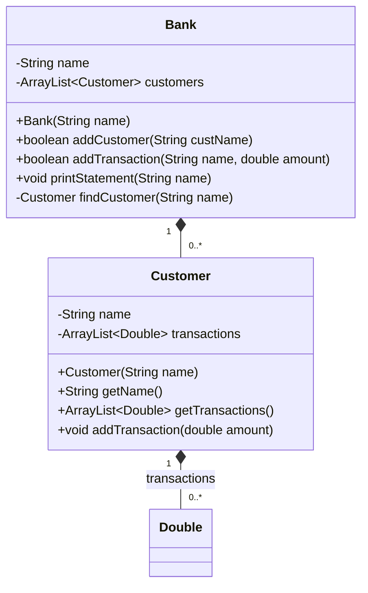

Yahya TALIB

# Lab 6 - Collections

Each problem has its own package under `src`. Run the `main` method in
`problem1.Shop`, `problem2.Main`, `problem3.Main`,
`problem4.ListPerformanceComparison`, or `problem5.Main` from IntelliJ IDEA.

## Problem 2 class diagram

## Problem 4 results and explanation

`ListPerformanceComparison` starts both lists with 100,000 identical integers.
It performs 10,000 insertion/removal pairs at seeded random middle indices,
10,000 insertions and removals at each end, and 10,000 seeded random reads.
The same indices and values are used for both list types, and the printed
sample sums confirm identical contents during the read test.

An example run on this machine gave approximately:

| Operation | ArrayList | LinkedList |
| --- | ---: | ---: |
| Random middle insert/remove | 70 ms | 1,366 ms |
| Insert/remove at both ends | 145 ms | 2 ms |
| Random `get(index)` | 2 ms | 385 ms |

`ArrayList` stores elements in an array. Middle insertions and removals shift
elements, but locating an index is immediate and copying nearby array elements
is fast. `LinkedList` can relink a node cheaply, but it first has to walk to
each random middle index; that traversal dominates this test. At the ends,
`LinkedList` changes only a few links, while `ArrayList` must shift elements
for every operation at index zero. For random access, array indexing is fast;
`LinkedList.get(index)` traverses nodes. Timings vary with the computer, JVM
warmup, and other running work, so the table is an illustrative run rather than
a fixed expected result.

## Problem 5 empty collections

`pop`, `dequeue`, and both `peek` methods return `null` when empty. The demo
in `problem5.Main` reproduces the stack and queue order shown in the lab.
